<p align="center">
  
</p>

<p align="center">
  
</p>

<p align="center">
  <a href="https://amirprgrmr.ir"></a>
  <a href="https://t.me/Amirprgrmr"></a>
  <a href="mailto:me@Amirprgrmr.ir"></a>
  <a href="https://github.com/Amirprgrmr?tab=repositories"></a>
</p>

---

### 👋 About Me

I am a 15-year-old software engineer and full-stack developer who lives in the world of **Linux (Parch / Arch)**, modern web architectures, and deliberate **UI/UX engineering**.

I don't just write code — I build finished, reliable digital products that balance robust backend logic with clean, intentional aesthetics. For me, software development is about solving concrete problems and refining every layer until it functions seamlessly in production.

```typescript
const life = (): string[] => {
  return ['programming', 'eating', 'sleeping'];
};

life();
```

> **"Build it right. Test it under real load. Refine the experience until it feels second nature."**

---

### 🚀 Selected Projects & Proven Systems

Curated production work, interactive web systems, and high-signal tools:

#### 🎓 [Taleqani School Online Exam System](https://amirprgrmr.ir/fa/project/taleqanischoolonlineexamsystem) · [Live Platform](https://tests.taleqanischool.ir)
A comprehensive, secure, and user-friendly full-stack EdTech platform engineered for institutional examinations.
- **Stress-Tested in Production:** Reliably served **~400 concurrent students** within a single hour and processed **3,545+ submitted answers** with zero downtime or data loss.
- **Student-Centric UX:** Hyper-focused, distraction-free examination interface equipped with interval auto-save and built-in interactive tools (drawing whiteboard, image uploads).
- **Security & Live Telemetry:** Real-time administrative monitoring, advanced anti-cheat behavioral detection, dynamic question/option shuffling, and automated report cards.
- `PHP` · `Modern Web Technologies` · `Full-Stack Development` · `UI/UX Engineering` · `Real-Time Telemetry` · `High Concurrency`

#### 🎸 [Arpeggio Guitars — 3D Interactive Showcase](https://amirprgrmr.ir/portfolio/guitar/)
An immersive WebGL & 3D product showcase for custom electric guitars.
- **Interactive Experience:** Real-time 3D model manipulation, dynamic material switching, and Web Audio API integration for authentic acoustic feedback.
- `Three.js` · `WebGL` · `Web Audio API` · `Responsive 3D` · `PHP`

#### 🍲 [Nisha Food — Artisanal Food Platform](https://nisha-food.ir)
A custom e-commerce solution built with tailor-made frontend components and a robust management backend.
- **Design Philosophy:** Graphite-clean UX, modular cart flows, and an intuitive ordering process built from the ground up without bloated templates.
- `Full-Stack Web` · `Custom Architecture` · `UI/UX Engineering`

#### 📋 [Taskora — Personal Planner & Productivity System](https://github.com/Amirprgrmr/Taskora)
A distraction-free, local-first task and goal management tool designed for developers.
- `JavaScript` · `State Management` · `Productivity Tooling`

---

### 🛠️ Technical Arsenal

<table>
  <tr>
    <td width="26%" valign="top"><strong>Frontend &amp; UI/UX</strong></td>
    <td width="74%">
      <code>Next.js</code> · <code>React</code> · <code>TypeScript</code> · <code>JavaScript</code> · <code>Tailwind CSS</code> · <code>Three.js / WebGL</code> · <code>HTML5 &amp; CSS3</code> · <code>UI/UX Engineering</code>
    </td>
  </tr>
  <tr>
    <td width="26%" valign="top"><strong>Backend &amp; CMS</strong></td>
    <td width="74%">
      <code>Node.js</code> · <code>Strapi 5</code> · <code>PHP</code> · <code>RESTful APIs</code> · <code>SQLite</code> · <code>MySQL</code> · <code>Server Architecture</code>
    </td>
  </tr>
  <tr>
    <td width="26%" valign="top"><strong>Systems &amp; DevTools</strong></td>
    <td width="74%">
      <code>C++ (GCC / Clang)</code> · <code>Parch / Arch Linux</code> · <code>Bash</code> · <code>Git &amp; GitHub</code> · <code>CMake &amp; Ninja</code> · <code>GDB</code>
    </td>
  </tr>
  <tr>
    <td width="26%" valign="top"><strong>Design &amp; Standards</strong></td>
    <td width="74%">
      <code>Adobe Photoshop</code> · <code>Design Systems</code> · <code>Responsive Typography</code> · <code>Dark Premium Styling</code>
    </td>
  </tr>
</table>

---

### 🧠 Environment & How I Work

- **Complete Products Over Toys:** A project isn't done when the happy path works. It's done when edge cases, loading states, error boundaries, and real user load are accounted for.
- **Restrained & Intentional Design:** I prefer dark graphite palettes, clear typographic scales, and purposeful micro-interactions over blinding neon gradients and visual clutter.

<details>
<summary><b>🐧 Operating System &amp; Daily Workspace</b></summary>
<br />

My primary daily workstation operates on **Parch Linux Desktop Edition** (an Arch-based distribution) running under **KDE Plasma (Wayland)**:
- **Terminal &amp; Shell:** Bash-driven workflows with automated developer aliases and custom scripts.
- **Build Toolchain:** GCC, Clang, CMake, Ninja, and GDB for native C++ development.
- **Philosophy:** Control, transparency, and a fast, clean system that gets out of the way of building software.

</details>

---

### 🐍 Contribution Activity

<p align="center">
  
</p>

<p align="center">
  
  
</p>

---

### 📬 Connect & Collaborate

Have a project idea, an open question, or want to discuss architecture and software engineering? Reach out anytime:

- **Portfolio & Blog:** [amirprgrmr.ir](https://amirprgrmr.ir)
- **Direct Telegram:** [@Amirprgrmr](https://t.me/Amirprgrmr)
- **Work Email:** [me@Amirprgrmr.ir](mailto:me@Amirprgrmr.ir)

<p align="center">
  <sub>Designed with precision · Built on Parch Linux · Tehran, Iran</sub>
</p>
