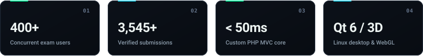
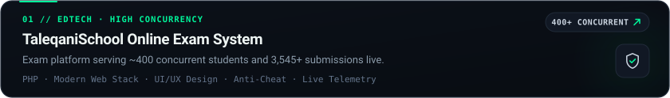
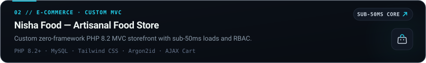
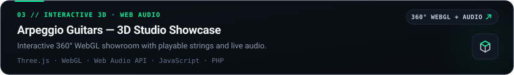
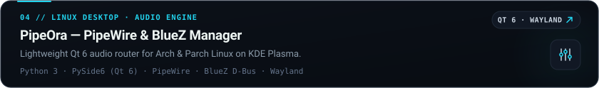
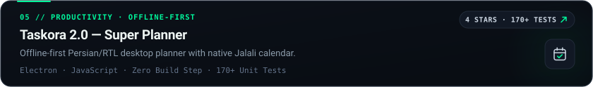
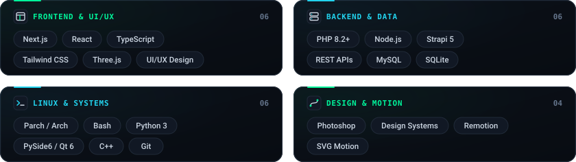

<p align="center">
  <a href="https://amirprgrmr.ir">
    <picture>
      <source media="(prefers-color-scheme: dark)" srcset="./assets/hero-dark.svg" />
      <source media="(prefers-color-scheme: light)" srcset="./assets/hero-light.svg" />
      
    </picture>
  </a>
</p>

<p align="center">
  <samp>
    <a href="https://amirprgrmr.ir">portfolio</a> ·
    <a href="https://amirprgrmr.ir/en/projects">projects</a> ·
    <a href="https://github.com/Amirprgrmr?tab=repositories">github</a> ·
    <a href="https://t.me/Amirprgrmr">telegram</a> ·
    <a href="mailto:me@Amirprgrmr.ir">email</a>
  </samp>
</p>

<p align="center">
  <picture>
    <source media="(prefers-color-scheme: dark)" srcset="./assets/metrics-dark.svg" />
    <source media="(prefers-color-scheme: light)" srcset="./assets/metrics-light.svg" />
    
  </picture>
</p>

## About

I'm Amirali Homayoonzadeh — a 15-year-old full-stack web developer and UI/UX designer based in Tehran, focused on Linux, modern web platforms, and building complete, reliable software from first commit to production.

I care about clarity across every layer: structured backend architecture, dependable performance under real traffic, and restrained interfaces free of visual noise.

```typescript
const life = (): string[] => {
  return ['programming', 'eating', 'sleeping'];
};

life();
```

## Selected Work

<p align="center">
  <a href="https://amirprgrmr.ir/fa/project/taleqanischoolonlineexamsystem">
    <picture>
      <source media="(prefers-color-scheme: dark)" srcset="./assets/project-taleqani-dark.svg" />
      <source media="(prefers-color-scheme: light)" srcset="./assets/project-taleqani-light.svg" />
      
    </picture>
  </a><br />
  <a href="https://nisha-food.ir">
    <picture>
      <source media="(prefers-color-scheme: dark)" srcset="./assets/project-nisha-dark.svg" />
      <source media="(prefers-color-scheme: light)" srcset="./assets/project-nisha-light.svg" />
      
    </picture>
  </a><br />
  <a href="https://amirprgrmr.ir/portfolio/guitar/">
    <picture>
      <source media="(prefers-color-scheme: dark)" srcset="./assets/project-arpeggio-dark.svg" />
      <source media="(prefers-color-scheme: light)" srcset="./assets/project-arpeggio-light.svg" />
      
    </picture>
  </a><br />
  <a href="https://github.com/Amirprgrmr/PipeOra">
    <picture>
      <source media="(prefers-color-scheme: dark)" srcset="./assets/project-pipeora-dark.svg" />
      <source media="(prefers-color-scheme: light)" srcset="./assets/project-pipeora-light.svg" />
      
    </picture>
  </a><br />
  <a href="https://github.com/Amirprgrmr/Taskora">
    <picture>
      <source media="(prefers-color-scheme: dark)" srcset="./assets/project-taskora-dark.svg" />
      <source media="(prefers-color-scheme: light)" srcset="./assets/project-taskora-light.svg" />
      
    </picture>
  </a>
</p>

<p align="center">
  <sub><samp>TaleqaniSchool Live Platform: <a href="https://tests.taleqanischool.ir">tests.taleqanischool.ir</a> · <a href="https://amirprgrmr.ir/en/projects">all projects</a></samp></sub>
</p>

<details>
<summary>More work &amp; experiments</summary>

- **[Amirprgrmr OS](https://amirprgrmr.ir)** — Bilingual (`/fa`, `/en`) Developer OS portfolio built with PHP, SQLite, and a custom Vanilla JS SPA with server-rendered SEO.
- **Nerkhora** — Serverless Telegram financial market super-bot for fast market tracking and automated updates.

</details>

## Capability Map

<p align="center">
  <picture>
    <source media="(prefers-color-scheme: dark)" srcset="./assets/stack-dark.svg" />
    <source media="(prefers-color-scheme: light)" srcset="./assets/stack-light.svg" />
    
  </picture>
</p>

## Environment & Approach

- **Complete products over demos** — Software is finished when loading states, error boundaries, and real user load are handled cleanly.
- **Restrained dark-first design** — Clear typographic scale, graphite surfaces, and purposeful motion without visual clutter.
- **Linux-native workflow** — Shell automation, transparent tooling, and direct control over the build and runtime environment.

<details>
<summary>Operating system &amp; daily setup</summary>

- **Operating System:** Parch Linux Desktop Edition (Arch-based) running **KDE Plasma (Wayland)**
- **Terminal &amp; Shell:** Bash-driven workflow with custom helper scripts and terminal automation
- **Native Build Tools:** GCC, Clang, CMake, Ninja, and GDB

</details>

---

<p align="center">
  <sub><samp>Amirali Homayoonzadeh · <a href="https://amirprgrmr.ir">amirprgrmr.ir</a> · Tehran, Iran</samp></sub>
</p>
